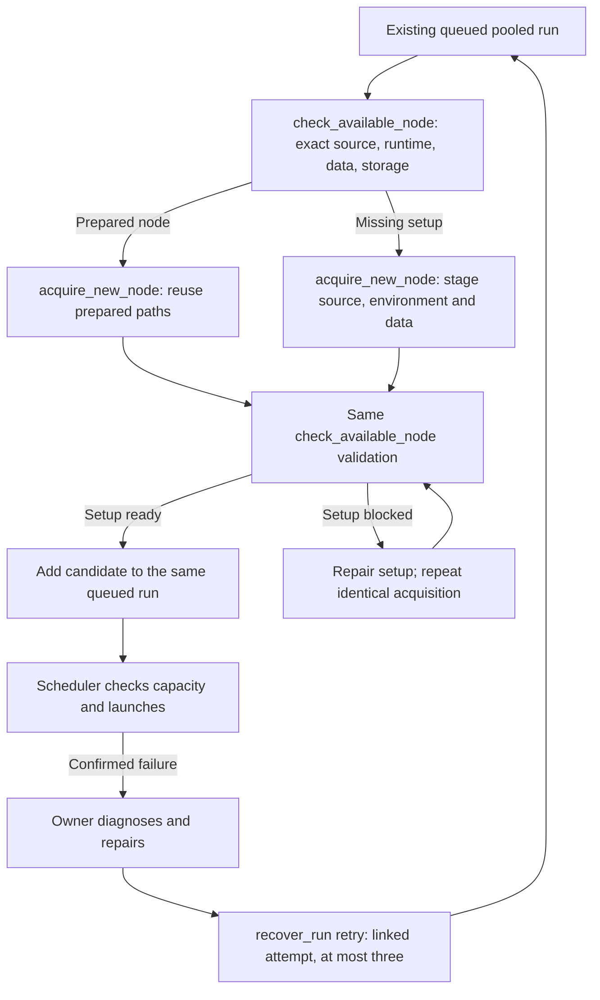

# Run acquisition and recovery

The worker keeps responsibility for the requested outcome. A missing path, full
candidate or confirmed failure prompts diagnosis and a supported repair, not a
routine manager handoff. Preserve the scientific protocol, resource request,
existing outputs and user stop orders. Ask the manager only for a real shared
conflict or capability unavailable to the owner.

A setup blocker is not itself a failed research run and does not call retry.
For a source compatibility defect before any launch attempt, `amend_source`
updates the reviewed commit in place and requires fresh candidate checks.
Ready setup and currently available GPUs are separate; no check reserves devices
or overrides budgets.

## Tools and authority

| Role/turn | Available workflow | Boundary |
|---|---|---|
| Worker user task | Check/acquire/recover within its experiment; pooled queueing saves its recovery owner | Actual user request and existing resource/protocol limits |
| Lead user task | Check/acquire and explicitly enable recovery of an existing project run | Cannot initially prepare/queue a run; do not take over another recovery owner |
| Manager user task | Same existing-run tools across the workspace; explicit manager-assigned queueing | Broader scope does not transfer an owner's recovery grant |
| Dedicated recovery wakeup | Check/acquire, register necessary hosts, pause/retry its saved latest run | Specific owner and lineage; alone it never grants generic user-origin authority |
| Accepted human steer or question answer during a wakeup | Resume the actual user instruction using the role's scoped tools | Delivery must succeed; keep existing receipts, ownership and resource limits |
| Ordinary scheduled check | Inspection and the saved observation/analysis | No acquisition, retry, budget changes or new launch |

Run tools use `run_id`; they do not take `project_id`/`experiment_id`. A recovery
grant never permits changing budgets, stopping other work, registering unrelated
capacity, replacing a whole pool or dispatching extra research. Normal shell and
network permissions still apply. A peer message cannot transfer or broaden it.

## Check or acquire a node

`check_available_node(run_id, host_id, node?)` checks a registered node against
that pooled run's exact commit and saved requirements. It may create an isolated
verification checkout and resolve its committed submodules; it is not merely a
metadata read, and never switches an existing worktree or allocates GPUs. Inspect
`checkout`, blockers, `ready`, `available` and check times. Unportable legacy runs
report unsupported intent; recover the actual specification rather than guessing.

`node` supplies prepared paths instead of the pool's configured node/defaults.
If supplied, it requires `host_id` and `repo_path`; Python/data/storage overrides
and a GPU subset are optional. Its host ID must match the tool's host. Reuse an
existing prepared environment first.

`acquire_new_node(run_id, host_id, node?, setup?)` applies only to a queued pooled
run. With prepared paths it checks and adds that node. For missing setup, supply:

- `setup.python`: an existing absolute base interpreter on the target.
- `requirements_file`: optional repository-relative file at the exact committed
  revision; requires the base interpreter and creates an isolated venv. It does
  not install into a shared environment.
- `data_source`: optional absolute source directory on the workspace, or on the
  registered `data_host_id` when supplied. Directory copying uses resumable
  checksum rsync; two remote endpoints may stage through the workspace, so verify
  adequate space there as well as on the target.

Setup bundles the exact Git revision into an isolated directory beneath the host
root, stages requested data/environment, calls the **same** readiness check, and
adds the resulting contract to the same queued run. By default, successful
acquisition also remembers an absent host for this project; shared defaults and
existing host configurations remain unchanged. Set `save_for_project: false` for
run-only acquisition, and inspect the returned `project_pool` result. Register a
genuinely missing host first; never duplicate a registration. Conda, containers and other
advanced environments are not synthesized automatically: prepare them with
permitted bounded shell work and pass verified paths for reuse.

Acquisition returns a durable ID immediately, not a readiness promise. Read
`recover_run(action: "status", run_id)` for acquisitions, errors and recovery
lineage. Repeating identical acquire fields resumes blocked/interrupted setup;
inspect a changed requirement before creating a different request. If the run
started or stopped meanwhile, prepared files do not establish candidate addition.
Confirm the saved receipt/current state. Scheduler allocation remains separate.

Replacing a candidate can intentionally cancel its obsolete admission check.
That cleanup does not cancel the run or establish an SSH outage; it must not
trigger a new queue request, host registration or repeated forced probes. Read
the current candidate/receipt and continue necessary remediation within the same
run and owner grant. Genuine connection failures and timeouts still use the
scheduler's bounded backoff; this cancellation fix does not authorize bypassing it.

## Persist and bound recovery

Worker queueing automatically enables recovery for a pooled run. To enable an
existing unowned run explicitly, use `recover_run` with `action: "enable"`, its
`run_id` and the concrete existing user `task`. Enable requires user-origin work;
another conversation's ownership cannot be silently replaced. Recovery wakeups
continue that owner on placement problems or failures without creating a generic
worker-monitoring rule. Do not manufacture a `wakeup_id` for them.

For the latest **confirmed failed** attempt, `action: "retry"` requires `reason`
explaining the diagnosed repair and explicit argv `command` using fresh outputs
or a verified resume point. Supply a full repaired `revision` and matching
`pr_url` when source changed; omitted values reuse the recorded revision/PR.
Exact-source verification still applies. Resources and protocol stay fixed.
The tool creates a linked attempt and new W&B identity, up to three retries;
retain both parent and child IDs. Read status after an uncertain result instead
of inventing a queue ID or bypassing the lineage. Cancelled, lost, uncertain or
still-active attempts cannot be retried. Exhausted retries require new direction.

If a recovery submission fails before returning a child `run_id`, inspect status
and resume `recover_run(action: "retry")` in the **same owning conversation**,
using the same failed parent `run_id`, repair command, revision and PR. The service
retains its deterministic submission identity and reserved W&B writer; agents do
not supply a replacement request ID. A supported repair of a rejected legacy
scheduler name reconciles that saved receipt before retrying. An uncertain or
conflicting receipt stays preserved rather than being guessed absent. Do not
submit a fresh `queue_run`, rename/delete service records or create another W&B
run to bypass this framework error. The same authorized repair needs no new
user approval or manager relay. If reconciliation still fails, keep the task
unresolved with the exact error while continuing independent work; do not loop
unchanged requests or claim that a replacement is queued without its run ID.

`action: "pause"` revokes recovery and stops its setup transfers without cancelling
the research run. Chat Stop and run cancellation also pause recovery. Do not
re-enable it from a scheduled/recovery turn or undo an explicit stop. Preserve
successful work and report an actual unresolved dependency if recovery cannot
proceed within the remaining grant, rather than widening scope or repeating an
unchanged failing action.

A linked recovery attempt also belongs in the research comparison. After queue
or recovery, use enabled `check_experiment_results` in the existing owner's scope
and preserve every earlier useful attempt and its measured/unavailable evidence.
Do not replace the report with only the first training attempt, invent missing
curves, or mark its required checkpoint complete through update_task. Follow
[Results checkpoint guidance](../../supersurfer-results/references/results-checkpoint.md).

A dedicated recovery owner may run the task’s configured check blocks, including
publication review, without routing through the lead. This does not enable
previews, arbitrary commands, other tasks or workflow edits.
