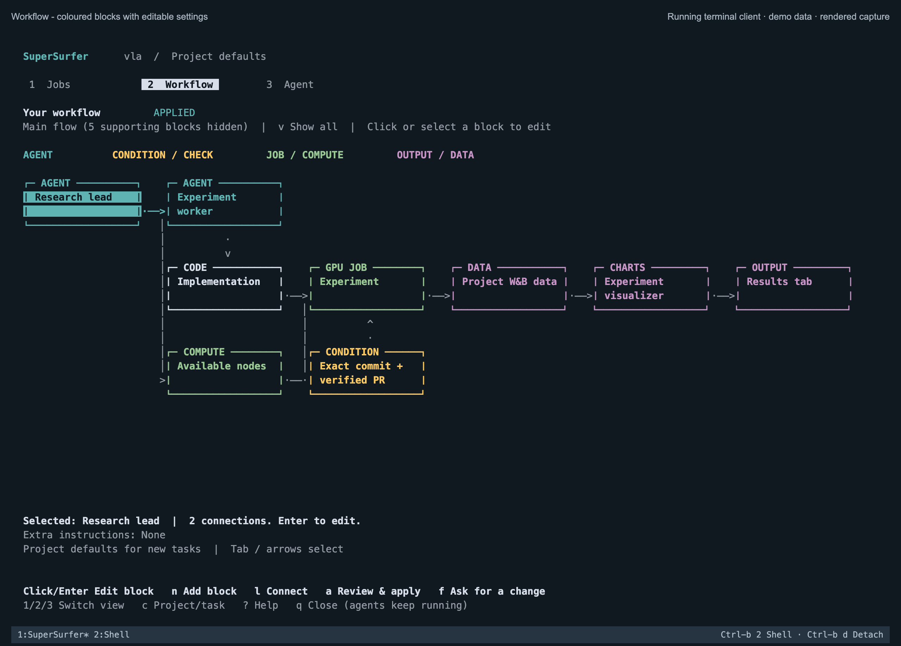

# SuperSurfer in tmux

Run the executable `surfer` from this checkout. It is one Python file, requires
Python 3.11+ and standard tmux, and connects to an **already running** SuperSurfer
workspace. It does not start, upgrade or restart the workspace service.

```sh
./surfer
```

The default screen has three clearly labelled views. Press **1 Jobs**, **2 Workflow**,
or **3 Agent**. A separate tmux Shell window is available with `Ctrl-b 2`.
`Ctrl-b 1` returns to SuperSurfer; `Ctrl-b d` detaches. Reopen with `surfer`.
Agents and jobs remain owned by your existing workspace service.

## Jobs

Select a named job with Up/Down and press Enter for its actions: move earlier/later,
hold, release through existing checks, or cancel. `p` pauses/resumes queue admission.
The page states that the queue covers the entire workspace, shows readable statuses,
and preserves unknown/stale GPU observations. Cancellation asks for confirmation.

## Workflow: edit the flowchart



Each block has a type label as well as a colour:

- Cyan: agents.
- Yellow: conditions, checks and schedules.
- Green: jobs and compute.
- Purple: outputs and data.

Click a block, or select it with Tab/arrows and press Enter. Its editor offers a
readable name, everyday settings such as **Maximum GPUs**, and connection controls.
`n` adds a block; `l` connects the selected block to another. Relationship choices
come from the service (for example, **Must be satisfied before** for a check).
The block editor can remove a connection or a block with confirmation.

The main flow hides supporting goal, notes, files, activity and timer blocks.
`v` shows the entire board. This is a view filter: hidden blocks retain all their
connections and behavior. Larger graphs scroll to the selected block. Arrows keep
the actual direction of each connection; selected connections are highlighted.
Failure/recovery arrows are shown for the selected block or in Show all.

Every edit creates a **draft**. Press `a` to review all changes and then explicitly
apply them. Review includes changes to hidden blocks and settings changed by other
interfaces. Version checks prevent overwriting a newer draft while editing or
reviewing. `d` reviews/discards a draft. `f` asks the persistent workflow editor to
propose a change in plain language and opens its conversation. Advanced JSON editing
is available with `x`; dragging blocks and bulk library rollout remain in the desktop.

Use `c` to choose a project and task. Project defaults apply to new tasks; existing
tasks retain their own boards.

## Agent

The Agent view shows who you are talking to, the provider and whether they are
working or waiting for you. Enter writes a message; `r` handles questions and
reviewed one-time approvals, `g` chooses a named conversation, and `s` stops a turn
with confirmation. PgUp/PgDn scroll history. Closing or detaching never stops work.

The client uses standard Python curses (normally included on Mac/Linux), Python
3.11+ and tmux. It is still a single executable file with no pip dependencies.
`surfer dashboard` opens the interface without tmux. The previous short commands
remain available through `surfer shell` or ordinary one-shot commands below.

## Connect

By default, the client discovers `~/.local/share/supersurfer/state/service.json`
and its adjacent `token`, falling back to `~/.supersurfer`. For a custom workspace:

```sh
./surfer --state-dir /path/to/existing/workspace/state
```

Install the standalone file somewhere on your PATH if desired:

```sh
mkdir -p ~/.local/bin
install -m 755 surfer ~/.local/bin/surfer
```

For Tulip or another Linux workspace, copy that same file there and run it **on
the workspace host**. No desktop application or JavaScript dependencies are needed:

```sh
ssh tulip 'mkdir -p ~/.local/bin'
scp surfer tulip:.local/bin/surfer
ssh -t tulip '~/.local/bin/surfer'
```

The remote host must have Python 3.11+, tmux, and the existing workspace service.
Provider login stays with the official CLI on that host. Reconnecting from another
terminal uses the same tmux session and persistent agents.

For an existing SSH tunnel, `--url http://127.0.0.1:PORT` overrides only the service
address; `--state-dir` must still point at a local directory containing the matching
workspace token. Tokens are read from disk, never passed in process arguments,
printed, or forwarded across HTTP redirects. Remote HTTP addresses are rejected.

`SURFER_STATE_DIR`, `SURFER_URL`, and `SURFER_HOME` provide the corresponding
defaults. Terminal selections and recoverable edits live under
`~/.local/state/supersurfer-terminal/` (or `$XDG_STATE_HOME`) separately from service
state. Use a different `--home` for independent selections and tmux sessions. The
dashboard layout uses a new session identity so upgrading leaves older command
prompts intact.

## Short commands

At the `surfer>` prompt, commands need no prefix. In a normal shell, prefix them
with `surfer`. Global options go before the command. `help` lists everything;
Tab completes command names.

```text
queue                      see GPUs and queued/running jobs
up RUN                     move a queued job earlier
down RUN                   move it later
hold RUN                   keep it queued but held
ready RUN [PR_URL]         release through existing workflow/source/PR checks
pause                      stop admitting new jobs; running jobs continue
resume                     resume admission
cancel RUN                 cancel one job, with confirmation
```

Use full IDs, unique ID prefixes, or exact names. Queue controls are workspace-wide,
even when a project is selected. Displays retain unknown/stale GPU observations.
Mutations are rejected when the scheduler is disconnected. Queue controls only
edit existing jobs; an explicit request in `chat` can still ask an agent to submit
work through the existing service. `ready` can start work once its checks pass;
`cancel` requests cancellation and the displayed state remains authoritative.

## Edit a Surfboard

```text
projects
use my-project
board
board edit
board apply
```

`board edit` opens JSON in `$VISUAL`, then `$EDITOR`, then `vi`. Change the `board`
field; leave project/task/version fields unchanged. Saving creates a server draft,
with validation errors shown in the terminal. `board apply` displays the exact
draft for confirmation and applies it with both original version numbers.

For a one-field change, use a node ID printed by `board`:

```text
board set NODE_ID FIELD VALUE
```

The field belongs to the node's `config`. Numbers, booleans, arrays and objects
are parsed as JSON; other values are strings. The service validates the node's
actual schema. For example, a compute node's `gpu_limit` field can be set to `4`.
Use single shell quotes around JSON arrays/objects when needed.

For a natural-language edit:

```text
board ask "Require the configured test check before publishing results"
```

This explicitly asks the persistent configurator for a **draft**, opens its
conversation, and uses the provider account configured for that conversation.
Use `/back`, inspect `board`, and `board apply` when ready. Model output is not
proof that a requirement is executable: inspect the compiled/validated proposal.

Select a task with `tasks` then `task TASK`. Its board is independent of the project
default. `task clear` returns to project defaults. Existing tasks are not bulk
updated by applying a project board. Named-library bulk rollout remains a desktop
operation in this initial terminal client.

Failed saves, conflicts, invalid JSON and cancelled editors retain the local file.
`board load FILE` retries a recovered envelope with its **original** target and
versions, so it cannot silently overwrite a newer edit. On a conflict, start a
fresh edit of the current board and manually reconcile the retained changes.
`board discard` confirms before discarding the current server draft.

## Persistent conversations

```text
agents
chat
backend
backend cursor
```

`chat` opens the selected task worker or project lead; `chat SCOPE` selects a listed
conversation explicitly. Model/provider settings, tools, questions, approvals,
history and session ownership remain in the workspace service. `backend NAME`
selects `codex`, `cursor` or `claude` only when the server permits it; existing
provider-bound conversations cannot silently migrate. New tasks/conversations and
account onboarding can still be managed through the desktop or existing lead.

Inside a conversation, enter a message normally. Responses refresh while the agent
works. Ctrl-c stops **watching**, then `/stop` explicitly stops that agent turn.
`/back` returns to the command prompt; `/refresh` reconnects to current progress.
Answer pending interactions with `/answer ID`, `/approve ID`, or `/deny ID` after
reviewing their displayed details. Approvals are one-time server-owned requests.
Provider/sandbox restrictions remain authoritative. No approval is automatic.

Closing tmux, exiting a view, or dropping SSH does not cancel an agent or GPU job.
The separate service must remain running for agents to continue. On an ambiguous
HTTP delivery, the client does not replay the action: inspect the same conversation,
queue or board before deciding to retry.

## Without tmux

`surfer shell` opens the same prompt directly. `surfer queue` and `surfer board`
print one snapshot; `surfer watch queue` and `surfer watch board` refresh every five
seconds. The default dashboard provides the coloured flowchart. Use the desktop editor for
dragging nodes or viewing rich HTML reports.

`--yes` skips the terminal confirmation for an explicitly requested apply, discard,
or cancellation. It never changes service permissions or agent approval policy.
