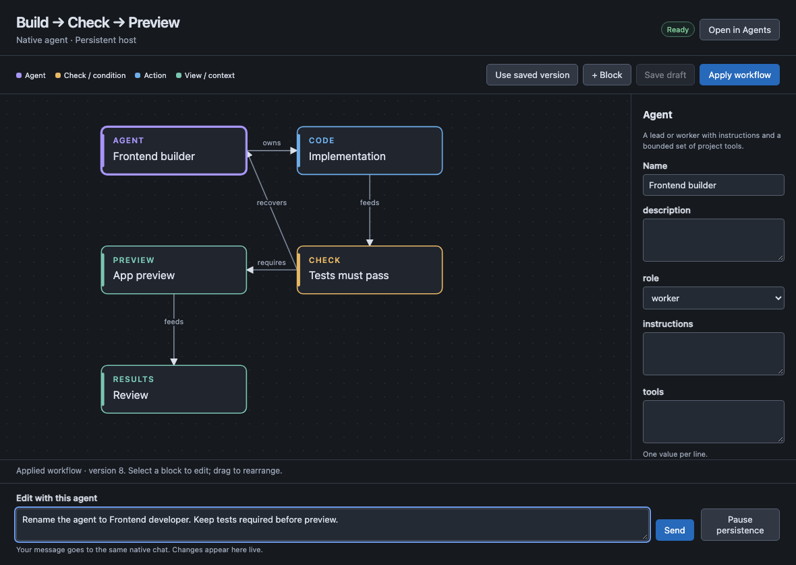
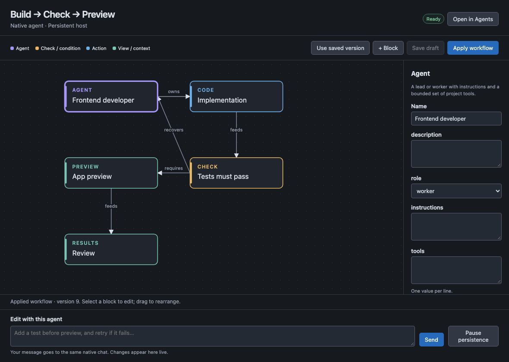

# Native workflow editor preview

These are captures of the actual extension webview in the browser regression
harness. Its message bridge connects to the real companion, real VS Code Agent
Host and SuperSurfer backend using a deterministic provider fixture. They are
not mockups, authenticated inference, or screenshots of the whole VS Code window.

